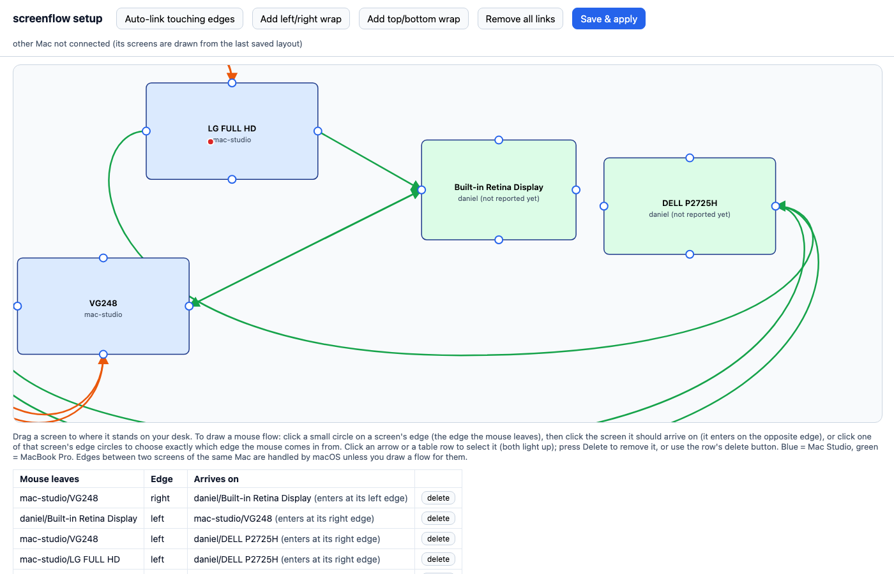
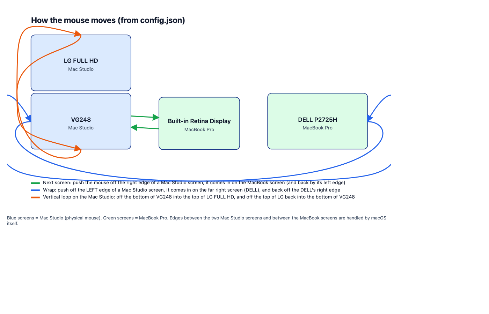

# MacBook Mouse Screen Flow Manager (screenflow)

One mouse across two Macs and all their screens, arranged the way they stand on your desk.
Push the cursor off the edge of one display and it comes in on the next one, even when that display belongs to the other Mac,
and loop from the last screen back to the first. No Synergy, no Universal Control, no cloud: a small native app on each Mac,
talking over your own network, and a local web page to draw the flows.



## What it does
- **Two Macs, one mouse.** The Mac with the physical mouse (here a Mac Studio with two monitors) forwards mouse movement,
  clicks and scrolling to the other Mac (a MacBook Pro with its built-in display and an external monitor) when the cursor
  crosses a linked edge. Push back against the edge to return.
- **Screen wrap.** Leave the left-most screen by its left edge and arrive on the right-most screen, or loop a stacked pair
  top to bottom. Each flow is "leave this edge of screen A, arrive on this edge of screen B", in any direction.
- **Desk-true layout.** The setup page shows every display both Macs report, with their real sizes. Drag them to match the
  desk, draw flows between edges, press *Save & apply*.
- **Live view.** The page shows whether the other Mac is connected and a red dot where the mouse is.



## Install (both Macs, once)
On each Mac, in Terminal:
```
cd ~ && curl -L https://github.com/profitelai/screenflow/archive/refs/heads/main.zip -o screenflow.zip \
  && unzip -q screenflow.zip && cd screenflow-main && ./install.sh
```
`install.sh` builds from source when the Swift compiler is present, otherwise uses the committed binary; it asks once for the
shared secret (the same string on both Macs, kept in `secret.txt`, never in git) and prints the displays it sees.
To update later, run the same command again (it replaces the folder; you will be asked for the secret again).

Then grant the permission macOS requires, once:
- **Both Macs:** System Settings > Privacy & Security > *Accessibility*: add Terminal, switch it on, then quit and reopen Terminal.
- **The Mac with the mouse only:** also *Input Monitoring*.

## Launch (every time)
Same command on both Macs; the script knows which role each computer has.

**1. The follower first** (the Mac without the mouse, here the MacBook Pro). In its Terminal:
```
cd ~/screenflow-main && ./start.sh
```
It prints `link up to mac-studio` and keeps retrying every 3 seconds until the mouse owner is up. Leave the window open.

**2. Then the mouse owner** (here the Mac Studio). In its Terminal:
```
cd ~/screenflow-main && ./start.sh
```
Within a few seconds **both** windows print `connected to <other machine>, displays: [...]`. From then on the mouse crosses
between the screens along the saved flows. `Ctrl+C` in a window stops that side; the other side keeps waiting.

To also open the setup page on the mouse owner: `./start.sh --setup` (it starts the page at http://127.0.0.1:8777/ and opens it).

### If it does not connect
| What you see | Cause | Fix |
|---|---|---|
| follower: `link to the other Mac closed` every 3 s; owner: `rejected connection: bad hello` | the two `secret.txt` files differ | on the owner: `cat secret.txt`; on the follower: `./install.sh` again and type that value |
| `connected to ...` shows **your own** displays | you started the follower config on the owner Mac (or the reverse) | use `./start.sh`, which picks the role from the computer name |
| `cannot create event tap` | Accessibility / Input Monitoring not granted to Terminal | grant it, quit and reopen Terminal, start again |
| follower: `cannot reach mac-studio` | name not resolving | in `config-daniel.json` replace `Danimasters-Mac-Studio.local` with the owner's IP (e.g. `192.168.0.164`) |
| mouse crosses but cannot come back, or `rejected connection: bad hello` right after an update | the two Macs run different builds (the sealed transport needs both updated) | update the other Mac with the install command above |
| cursor fights or jumps | macOS Universal Control is on | turn it off in Displays > Advanced on either Mac |
`Escape` three times quickly on the owner's keyboard always brings the mouse back.

## Set up the flows
On the Mac that owns the mouse: `./start.sh --setup`, or just `python3 server.py` and open http://127.0.0.1:8777/.

- Drag each screen to where it stands on the desk.
- Click the small circle on the edge the mouse **leaves**, then click the screen it should **arrive on**
  (it enters on the opposite edge), or click that screen's edge circle to choose the exact arrival edge.
- Click an arrow or a table row to select it; *Delete* removes it. *Auto-link touching edges* draws the flows between the two
  Macs where screens touch; the *wrap* buttons add the loop-arounds.
- **Save & apply** writes `config.json`, restarts the app, and the other Mac receives the new flows when it reconnects (a few seconds).
Only `config.json` on the mouse-owner Mac matters; the follower gets its links over the connection.

## Safety and limits
- **Escape pressed three times** within 1.5 s on the mouse owner's keyboard always brings the mouse back.
- The mouse is only handed over when the other Mac is connected, authenticated with the shared secret, and has reported the target display.
- Keyboard input is never forwarded.
- **Encryption.** Each connection starts with a nonce exchange; both sides derive a one-time session key from the shared secret
  (HKDF-SHA256), and every message after that is sealed with ChaCha20-Poly1305 (CryptoKit). The secret itself is never sent,
  a wrong secret simply fails to decrypt, a per-message counter rejects replays, and anything unencrypted after the handshake
  closes the link. `tools/crypto_test.py` exercises all of this against a dry-run owner. Still meant for your own LAN: there is
  no certificate pinning, so use a long secret.
- Each app refuses to connect to a copy of itself on the same computer.
- **Follower pinning.** The first computer that connects with the right secret is remembered (`peer_host` in `config.json`);
  any other computer is refused even with the secret. To switch laptops, delete that line and restart.
- **Setup page token.** `server.py` prints a one-time URL with `?token=...`; only pages opened from it can read or change
  the flows, so another program on the same Mac cannot rewrite them. `./start.sh --setup` opens the right URL for you.
- The installer makes a 32-character secret; when you rotate it, both Macs must get the new one.
- Turn off macOS **Universal Control** between the two Macs (Displays > Advanced), or both will try to move the cursor.
- `./screenflow <config> --check` prints the displays and links; `--dry-run` logs instead of moving anything.

## Files
`main.swift` (the app, one file) · `screenflow` (prebuilt) · `config.json` / `config-daniel.json` · `install.sh` · `start.sh` ·
`server.py` + `setup.html` (the setup page) · `make_flow.py` (flow picture) · `make_layout.py --watch` (live layout page).
